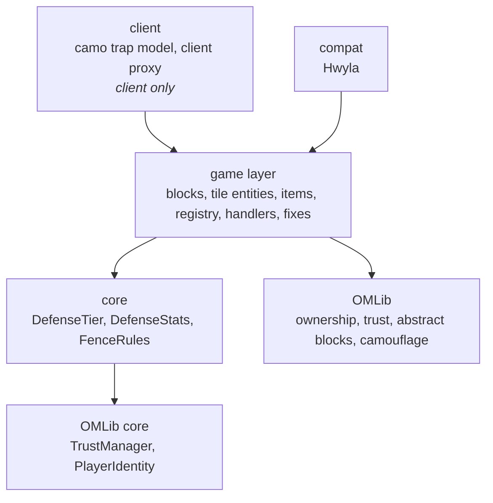

# Architecture

A guide to the code of Open Modular Passive Defense (OMPD) on Minecraft 1.12.2 (branch `1.12`) for people working on it: how it is layered, what lives where, how the main flows run, and how to add the common things.
It describes the code as it is; where it falls short of its own rules, the last section says so.

The guide follows the one of the 1.20.1+ port (`docs/architecture.md` on OMT's branch `1.20.1+`), where OMPD's blocks are part of the merged mod.
There is no Stonecutter build and no `platform/` layer, because 1.12.2 has one loader (Forge), and it uses MCP names (`TileEntity`, `IBlockState`) instead of Mojmap ones.
Building, running, releases and the rules for working on the code are in the workspace `CLAUDE.md` (OMTTeam 1.12 workspace).

OMPD requires OMLib (`required-after:omlib`), which provides almost everything the blocks are built on: ownership and trust lists, the abstract block and tile entity classes, the camouflage menu and its model.
Read OMLib's `docs/architecture.md` first; this mod is small because of it.

## The idea in one paragraph

OMPD adds **passive defenses** that complement the turrets: hardened blocks, walls and fences in five tiers, and a camouflage trap.
Every block is an owned block of OMLib: it has an owner and a trust list, and the owner's team and trusted players are treated as friendly (except by fences, which spare only the owner, as on 1.20.1+).
The few rules OMPD has of its own (what a tier is, whom a fence hurts) are plain Java in `core`, without any Minecraft class, so they are unit-tested in milliseconds.
The blocks and tile entities translate between Minecraft and these rules and stay thin.

## Layers

An arrow means "may use".
The other directions are forbidden and checked by the build (see [Rules the build checks](#rules-the-build-checks)):

- **core** uses only Java, itself and OMLib's `core`: no Minecraft, Forge, `com.mojang` or non-core packages.
- **common code** never uses **client** code: client classes do not exist on a dedicated server.
  Forge 1.12 dev environments have no separate client source set, so `client` is a package; common code reaches it only through the proxy (`@SidedProxy`: `CommonProxy`, `client.ClientProxy`).

### How core talks to the game

OMPD's core needs nothing from the world, so it has no world interfaces; it takes OMLib's core types as arguments:

| Core class | Used by | What it decides |
| --- | --- | --- |
| `core.DefenseTier` | `BlockHardened`, `BlockWall`, `BlockFence`, their items | tiers 1–5 as the metadata 0–4 of the 3.x blocks, clamping of invalid metadata |
| `core.DefenseStats` | `config.ConfigHandler`, the three blocks | hardness, explosion resistance and fence damage per tier: the config values, checked (an invalid list gets the defaults) |
| `core.FenceRules` | `BlockFence.onEntityCollision` | whom a fence hurts on contact: everything living except the owner (and shared owners, the 1.12 owner concept), as on 1.20.1+ |

`FenceRules.hurts` gets the fence's OMLib `TrustManager` (`core.security`) and the touching player as a `PlayerInfo`, if it is one; the block turns the colliding `Entity` into that argument.

The tile entities own the trust manager: `TileEntityPassiveTiered` and `TileEntityCamo` hold OMLib's `TrustedPlayersManager` (the facade over `core.security.TrustManager`).

## Where things live

| Path | Contents | Shipped |
| --- | --- | --- |
| `src/main/java` | all code; client code in the `client` package | yes |
| `src/main/resources` | `assets/ompd` (models, blockstates, lang, textures, handwritten recipes), `mcmod.info` | yes |
| `src/test/java` | JUnit 5 tests of the core and the data fixer, and the architecture rules | no |
| `src/test/resources/archunit_store` | the frozen architecture violations (a ratchet) | no |

Packages below `omtteam.ompd`:

| Package | Responsibility |
| --- | --- |
| (root) | `OpenModularPassiveDefense` (the `@Mod`: start-up and the data fixer), `CommonProxy` |
| `core` | `DefenseTier`, `FenceRules` |
| `block` | `BlockHardened` (a full block, `IPlainLookingBlock`: it can serve as a disguise), `BlockWall`, `BlockFence` (they extend OMLib's abstract wall and pane), `BlockCamoTrap` (OMLib's camouflage block) |
| `tileentity` | `TileEntityPassiveTiered` (tier, owner and trust list of hardened blocks, walls and fences), `TileEntityCamo` (the trap: disguise, light, trust list), `OwnerOverlay` (the owner line of Hwyla and The One Probe) |
| `item` | `ItemBlockHardened`, `ItemBlockWall`, `ItemBlockFence`: the tier is the item's metadata |
| `registry` | `ModBlocks` (blocks and tile entities), `ModItems`, `OpenModularPassiveDefenseTab` |
| `handler` | `EventHandler` (registry events), `GuiHandler` |
| `network` | `NetworkingHandler` (the channel; OMPD has no messages of its own, the camouflage menu uses OMLib's) |
| `config` | `ConfigHandler` |
| `fixes` | `TENameFix`, the data fixer for the 3.x tile entity names |
| `util` | `BlockHelper`: placing (owner and tier) and the click shared by the tiered blocks |
| `compat` | `ModCompatibility` (registers with OMLib's Hwyla plugin), `WailaTileHandler` (owner line), `WailaCamoTrapHandler` (the trap's disguise) |
| `client` | `ClientProxy`, `ClientEventHandler`, `client.model.BasicCamoTrapBakedModel` (the trap's model on top of OMLib's `CamoBakedModel`) |

`./gradlew dependencyMap` draws these packages and every import between them as an interactive page.

## How the main flows run

### Startup

`OpenModularPassiveDefense.preInit` loads the config (`ConfigHandler.init`) and calls `proxy.preInit()`; `CommonProxy.initHandlers` registers the networking and the event handler, the client proxy adds its own handlers and model loaders.
Blocks, items and sounds are registered in `RegistryEvent.Register` (`EventHandler` → `ModBlocks.initBlocks` / `ModItems`); the tile entities are registered with the blocks.
`init` registers the GUI handler and the data fixer (`TENameFix`, data version in the mod class), and the mod compat.

### Tiers

A hardened block, wall or fence is one block with the tier in its **metadata** (0–4 = tier 1–5, as in 3.x), so the registry names and the placed blocks of 3.x stay valid.
`DefenseTier.fromMeta` clamps invalid metadata; hardness, explosion resistance and the fence damage come from the config (`ConfigHandler.getDefenseStats()`, section `tiers`), synced to clients through OMLib's `ConfigSync` (registered in `CommonProxy.preInit`), since the client predicts mining progress from the hardness.
The item carries the tier as its damage value (`ItemBlock*.getMetadata`), the creative tab lists all five, and `damageDropped` / `getPickBlock` keep the tier.
`TileEntityPassiveTiered` stores the tier too, together with the owner and the trust list.

### Placing and owning

`BlockHelper.onBlockPlacedByTiered` writes the tier into the tile entity and makes the placing player the owner (`onBlockPlacedBy`); blocks placed by other entities (deployers, other mods) stay unowned.
An unowned block sparkles green on the client (`randomDisplayTick`) so players see that they can claim it; OMLib's `OwnershipInteraction` does the claiming and the wand, and the connected blocks are claimed together (`ClaimSpread`).
Clicking a block with the wrench or opening its trust list goes through `BlockHelper.onBlockActivated` and OMLib's shared GUI.

### A fence touch

`BlockFence.onEntityCollision` (server) asks `FenceRules.hurts` with the fence's trust manager and the touching player (as an OMLib `PlayerInfo`); only the owner and shared owners are spared, trusted players, the team and pets are hurt, as on 1.20.1+.
Dropped items are left alone by the block; what is hurt takes the fence's damage.

### The camouflage trap

`BlockCamoTrap` extends OMLib's `BlockAbstractCamoTileEntity` and `TileEntityCamo` implements `ICamoSupport`, so the trap looks like the block it is set to and everything about the disguise is OMLib's (see its camouflage section):

- Whoever may change the camouflage (`canSetCamo`: the owner and admins) opens OMLib's camouflage menu with the main hand; everyone else gets nothing, so the trap does not reveal itself.
  Sneaking skips the menu, so blocks can still be placed against the trap.
- The trust list has two levels (`AccessProfile.TRUSTED_AND_ADMIN`): trusted players can stand on the trap (it is solid only for the owner, trusted players and the owner's team, `addCollisionBoxToList`; everyone and everything else falls through), admins also change the camouflage and manage the list.
  3.x traps have no list and keep working.
- The light sliders of the menu apply to the trap (`supportsLight`); `getLightValue` and `getLightOpacity` read the camouflage settings.
- The trap mines with the tool of its disguise.
- On the client `BasicCamoTrapBakedModel` extends OMLib's `CamoBakedModel` and renders the disguise (or the trap's own model without one).

### Worlds from version 3.x

Registry names (`ompd:hardened`, …), metadata and the NBT keys stay as in 3.x; `TileEntityPassiveTiered` and `TileEntityCamo` read the old keys.
`fixes.TENameFix` renames the 3.x tile entity ids through a `ModFixs` data fixer.
Every change to ids, metadata, NBT or config keys is checked against the 3.x test worlds (`runenv/compat/compat-test.sh verify 3.1.14` and `verify 3.2.0` in the workspace).

## How to add …

### A tiered block

Give the block five metadata variants like `BlockHardened`: tier from `DefenseTier.fromMeta`, hardness and resistance from `ConfigHandler.getDefenseStats()`, an `ItemBlock` that uses the damage value, and `TileEntityPassiveTiered` for the owner and trust list.
Register block and tile entity in `ModBlocks` and the item in `ModItems`.
New ids are lowercase `snake_case`; the existing 3.x ids and metadata stay untouched.
Blockstate, models, textures (human-made; use a placeholder and say which are missing), lang and a handwritten recipe in `assets/ompd/recipes`.

### A rule

Put it in `core` with a unit test first, taking OMLib's core types as arguments (like `FenceRules`), and let the block translate.

### Code that needs the client

Anything that touches `Minecraft`, rendering or screens goes into `client` and is reached from common code through the proxy; `ArchitectureTest` fails otherwise.

### Something shared with the other mods

Owner, trust, camouflage, wrench and GUI code belong in OMLib, not here.

## Rules the build checks

`./gradlew check` fails when one of these is broken:

| Rule | Checked by |
| --- | --- |
| core uses only Java, core and OMLib core | `ArchitectureTest.coreDependsOnlyOnCoreAndJava` and the `verifyCoreIsolation` task |
| common code reaches `client` only through the proxy | `ArchitectureTest.commonCodeReachesClientCodeOnlyThroughTheProxy` (frozen in `src/test/resources/archunit_store`, empty now) |
| no new package cycles, and the known ones only shrink | `ArchitectureTest.noNewPackageCycles` (list `KNOWN_CYCLES`) |
| core rules behave as specified | `DefenseTierTest`, `DefenseStatsTest`, `FenceRulesTest` |
| the 3.x tile entity names are renamed | `TENameFixTest` |

There are no GameTests on 1.12: in-game behaviour is checked with the dev client and server in the workspace (`./gradlew :runenv:runServer -Pomcompat_action=boot`) and with the 3.x compatibility worlds.
`KNOWN_CYCLES` and the frozen store are ratchets; when the cycle test fails it prints the cycle, the class dependencies inside it (fewest first) and the updated list.
Never add to either without asking the user.

## Measuring code quality

| Tool | Command | Output |
| --- | --- | --- |
| Test coverage of `core` (JaCoCo) | part of `check`, which prints the line coverage per package | `build/reports/jacoco/test/html/index.html` |
| Mutation testing of `core` (PIT, on demand) | `./gradlew pitest` | `build/reports/pitest/index.html` |
| Dependency map | `./gradlew dependencyMap` | `build/reports/dependency-map/index.html` |

Run Gradle with a JDK 17+ in `JAVA_HOME`; the mod compiles and tests on the Java 8 toolchain.
Coverage says which lines the tests run; mutation testing says whether they check the results.

## Known weak spots

Things that make the code harder to work with than they should be.
They are known, not hidden:

- **One small package cycle.** The root package, `block`, `fixes`, `handler`, `item` and `registry` depend on each other in a loop (registry ↔ blocks, as in most Minecraft mods); `noNewPackageCycles` keeps it from growing.
- **`util.BlockHelper` is a grab-bag.** Placing and clicking logic shared by the tiered blocks; it should move next to what it serves (an abstract tiered block or `TileEntityPassiveTiered`).
- **The core is small.** Hardness, tiers and the fence rule are tested; the other behaviour (collision of the trap, claiming sparkle) lives in the blocks and is checked by hand.
- **Client code in the main source set.** The client rule is enforced by a test, not by the compiler.
- **The client is untested** except by hand; check models and the trap with `runClient` in the workspace.
- **Phase 8 is not merged.** New tiered blocks (gates, doors, heavy door, lamp, spikes) and the simpler recipes live on the branch `phase-8-ompd`; this document describes `1.12` without them and has to be extended when they land.
